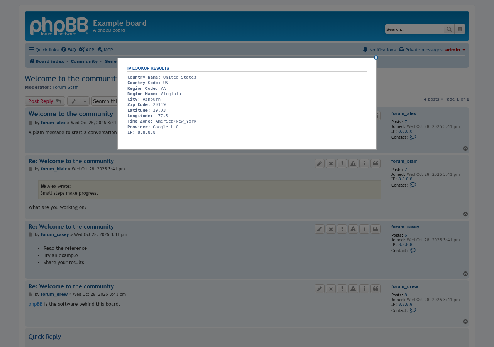

# Poster IP in Viewtopic

 

Allows moderators and administrators to view the IP of the poster when viewing a topic.

## Features

- Shows each post's IP address in the post's profile column, visible only to administrators, global moderators and moderators of that forum.
- Click the IP address to look it up. A popup shows the country, region, city, postal code, time zone, location and provider.
- The lookup is done by [ip-api.com](https://ip-api.com/). The board sends the poster's IP address to that service over plain HTTP. The lookup needs JavaScript.

## Screenshots

<table>
  <tr>
    <td align="center"> The IP address in the post's profile column</td>
    <td align="center"> The lookup popup</td>
  </tr>
</table>

Click a screenshot for the full size.

## Requirements

- phpBB 3.3.19 or later
- PHP 8.3.36 or later
- The PHP cURL extension, for the IP lookup

## Installation

1. Copy the extension to `/ext/phpbbmodders/posteripinviewtopic`
2. In the Administration Control Panel, go to **Customise → Manage extensions**
3. Enable the **Poster IP in Viewtopic** extension

### Upgrading from `rmcgirr83/posteripinviewtopic`

This extension used to be Rich McGirr's `rmcgirr83/posteripinviewtopic`. To move to this version:

1. Disable the old **Poster IP in Viewtopic** extension in the ACP. Do **not** delete its data.
2. Upload this version to `/ext/phpbbmodders/posteripinviewtopic` and enable it. The new version won't enable while the old one is still on, and it removes the old extension's entry from the extension list when it is enabled.
3. Delete the `/ext/rmcgirr83/posteripinviewtopic` folder and purge the board cache.

If you disable the old extension from the command line (`bin/phpbbcli.php`) instead of the ACP, run `bin/phpbbcli.php cache:purge` before enabling the new one; the command-line disable doesn't clear the cache.

## Contributing

Contributions are welcome!

- **Bug reports**: [Open an issue](https://github.com/phpbbmodders/posteripinviewtopic/issues).
- **Everything else** (questions, feature requests, ideas, general discussion): [Use Discussions](https://github.com/orgs/phpbbmodders/discussions), or the [community forum](https://www.phpbbmodders.com/community/).
- Pull requests are welcome for bug fixes or discussed features.

## Acknowledgments

- Extension by Rich McGirr ([RMcGirr83](https://github.com/rmcgirr83)).
- Documentation assisted by [Claude](https://www.anthropic.com/claude).

## License

This extension is licensed under the **GNU General Public License v2.0**.

See [license.txt](license.txt) for more information.
